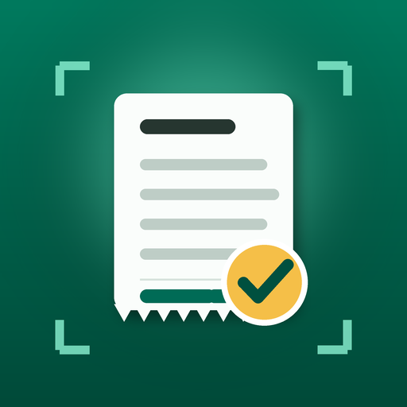

<div align="center">



# TidyNote

**Pencatat belanja offline-first untuk UMKM Indonesia — scan struk, langsung tercatat.**

TidyNote (NotaRapi) memindai struk belanja dengan ML Kit di perangkat, mem-parsing-nya
dengan aturan Indonesia (IDR, NPWP, PPN 11%), dan menyimpannya sebagai catatan
pengeluaran yang rapi — tanpa akun, tanpa pelacakan, tanpa internet.

<br />

[](https://github.com/s3r3/tidynote/releases)
[](LICENSE)
[](#-persyaratan)
[](#-persyaratan)

[](https://kotlinlang.org)
[](https://developer.android.com/jetpack/compose)
[](https://developers.google.com/ml-kit)
[](https://gradle.org)
[](PRIVACY.md)

<br />

[**Fitur**](#-fitur) &nbsp;·&nbsp;
[**Video Promo**](#-video-promo) &nbsp;·&nbsp;
[**Memulai**](#-memulai) &nbsp;·&nbsp;
[**Backend AI**](#-backend-ai-opsional) &nbsp;·&nbsp;
[**Laporkan Bug**](https://github.com/s3r3/tidynote/issues)

</div>

---

## 📑 Daftar Isi

- [Fitur](#-fitur)
- [Video Promo](#-video-promo)
- [Teknologi](#-teknologi)
- [Persyaratan](#-persyaratan)
- [Memulai](#-memulai)
- [Struktur Proyek](#-struktur-proyek)
- [Backend AI (Opsional)](#-backend-ai-opsional)
- [Rilis](#-rilis)
- [Privasi](#-privasi)
- [Lisensi](#-lisensi)

---

## ✨ Fitur

<table>
  <tr>
    <td width="50%" valign="top">

### 📷 Scan & OCR Offline
- ML Kit Document Scanner: deteksi & potong struk otomatis
- Text Recognition berjalan **di perangkat** — tanpa internet
- Bisa juga pilih foto struk dari galeri

    </td>
    <td width="50%" valign="top">

### 🧾 Parser Indonesia
- Ekstraksi merchant, tanggal, item, subtotal, diskon, total
- Mendukung format **IDR, NPWP, dan PPN 11%**
- Indikator *confidence* per hasil — nilai meragukan ditandai untuk diperiksa

    </td>
  </tr>
  <tr>
    <td width="50%" valign="top">

### ✅ Review & Koreksi
- Semua nilai hasil scan bisa diedit manual sebelum disimpan
- Kategori bawaan: Makanan & Minuman, Bahan Baku, Peralatan, Kebersihan, Transport, Lainnya
- Opsi **Perbaiki dengan AI** (opt-in, lihat Backend AI)

    </td>
    <td width="50%" valign="top">

### 📊 Dashboard & Riwayat
- Total belanja bulan ini, struk yang perlu diperiksa, transaksi terbaru
- Grafik pengeluaran per kategori
- Riwayat lengkap: cari, filter, duplikasi, bagikan, detail + foto struk

    </td>
  </tr>
  <tr>
    <td width="50%" valign="top">

### 💾 Ekspor & Backup
- Ekspor catatan ke **CSV** dan **PDF**
- Backup terenkripsi (Google Tink) + restore

    </td>
    <td width="50%" valign="top">

### 🔒 Privasi
- **Tanpa akun, tanpa iklan, tanpa pelacakan**
- Semua data di perangkat; backup sistem Android untuk database dinonaktifkan
- AI cloud mati secara default — lihat [PRIVACY.md](PRIVACY.md)

    </td>
  </tr>
</table>

---

## 🎬 Video Promo

<div align="center">

<video src="https://raw.githubusercontent.com/s3r3/tidynote/main/docs/promo-tidynote.mp4" controls width="720"></video>

<br />

[Tonton / unduh video promo](docs/promo-tidynote.mp4)

</div>

---

## 🛠 Teknologi

| Area | Pilihan |
|------|---------|
| **Bahasa** | Kotlin 2.2.20 |
| **UI** | Jetpack Compose (BOM 2024.10.01), Material 3 |
| **OCR** | ML Kit Document Scanner + Text Recognition (on-device) |
| **Persistence** | Room 2.8.5, DataStore 1.1.1 |
| **DI** | Koin 3.5.6 |
| **Gambar** | Coil 2.7.0 |
| **Background work** | WorkManager 2.9.1 (retry ekstraksi AI) |
| **Backend** | Ktor 3.1.3 (modul `:backend`, deploy terpisah) |
| **Build** | Gradle 9.8.0, AGP 8.7.3, version catalog (`gradle/libs.versions.toml`) |

> **SDK:** `minSdk` 29 · `compileSdk` / `targetSdk` 36 · JVM target 21

---

## 📋 Persyaratan

- JDK 21
- Android SDK 36
- Perangkat/emulator Android 10+ (API 29)

---

## 🚀 Memulai

```bash
git clone https://github.com/s3r3/tidynote.git
cd tidynote
./gradlew :app:assembleDebug
./gradlew :app:installDebug   # dengan perangkat/emulator terhubung
```

Debug APK: `app/build/outputs/apk/debug/app-debug.apk`
(varian debug memakai `applicationId` suffix `.debug`, bisa berdampingan dengan versi rilis.)

---

## 🗂 Struktur Proyek

```
app/                          # Modul aplikasi Android (com.notarapi.tidynote)
  feature/
    onboarding/               # Onboarding + MainActivity
    home/                     # Beranda & ringkasan
    scan/                     # Alur pemindaian struk (ML Kit)
    review/                   # Review & koreksi hasil OCR
    detail/                   # Detail struk
    history/                  # Riwayat, ekspor CSV/PDF
    dashboard/                # Statistik & grafik kategori
    settings/                 # Pengaturan, AI, hapus data
  core/
    database/                 # Room (struk, item, kategori)
    model/ storage/ prefs/    # Model, file gambar struk, preferensi
    backup/                   # Backup terenkripsi (Tink) & restore CSV
    util/                     # Confidence color, dsb.
  data/receipt/               # Repository struk
  extraction/
    ocr/                      # ML Kit OCR helper
    parser/                   # Parser struk Indonesia (IDR/NPWP/PPN)
backend/                      # Proxy Ktor untuk AI cloud (opsional, deploy sendiri)
```

---

## 🤖 Backend AI (Opsional)

Aplikasi bekerja penuh secara offline. Bantuan AI cloud hanya aktif jika kamu
menjalankan backend sendiri dan mengaktifkannya di **Pengaturan → AI**:

- Backend menerima teks OCR (bukan foto) lewat `POST /v1/receipts/parse`
- Kredensial lewat environment: `PROVIDER_API_KEY`, `APP_TOKENS`
- Jalankan: `./gradlew :backend:run` (port 8080)

Detail integrasi: [INTEGRATION_NOTES.md](INTEGRATION_NOTES.md).
Di build produksi, `LLM_API_KEY` pada `local.properties` **harus kosong** — nilai itu
tertanam di APK dan hanya untuk demo internal.

---

## 📦 Rilis

```bash
./gradlew :app:bundleRelease
```

Menghasilkan AAB di `app/build/outputs/bundle/release/` (minify + shrink resources aktif).

---

## 🔐 Privasi

TidyNote **tidak mengumpulkan data pribadi dan tidak membagikan data ke pihak ketiga**.

- OCR berjalan di perangkat; foto struk tersimpan lokal di penyimpanan aplikasi.
- AI cloud **default mati**. Hanya jika kamu mengaktifkannya dan menekan
  *Perbaiki dengan AI*, teks OCR (maks. 8.000 karakter, bukan foto) dikirim ke backend kamu sendiri.
- Tidak ada akun, pelacakan iklan, atau pengiriman data otomatis.

Teks lengkap: [PRIVACY.md](PRIVACY.md).

---

## 📄 Lisensi

Didistribusikan di bawah [Apache License 2.0](LICENSE).
Notices pihak ketiga: [THIRD_PARTY_NOTICES.md](THIRD_PARTY_NOTICES.md).

<div align="center">

<br />

Dibuat untuk warung & toko kecil Indonesia 🇮🇩

⭐ **Kalau TidyNote berguna buatmu, kasih star ya!**

</div>
